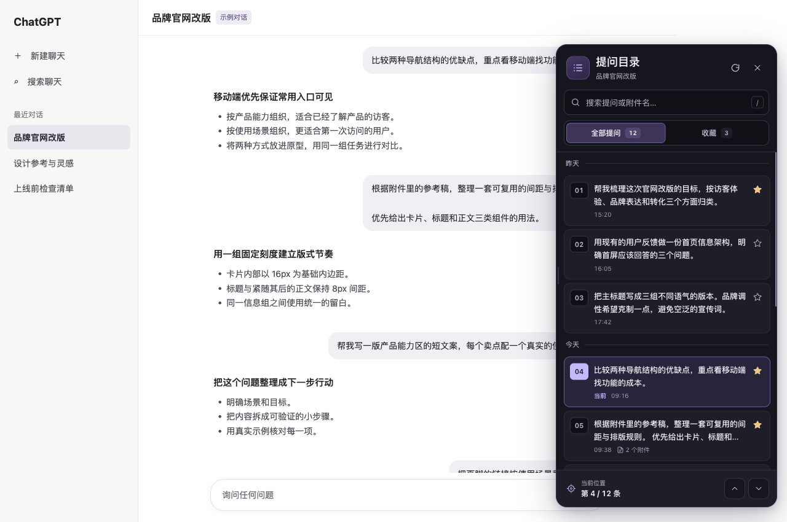

<h1 align="center">Turn Outline for ChatGPT</h1>

Find your own prompts in long ChatGPT conversations. Hover to preview, click to jump, or open the outline to search and save prompts.

<a href="https://github.com/HFUT-zhengjiahao/chatgpt-turn-outline/releases/latest/download/chatgpt-turn-outline.zip"><strong>Download the latest ZIP</strong></a> · <a href="https://github.com/HFUT-zhengjiahao/chatgpt-turn-outline/releases">Releases</a> · <a href="README.md">简体中文</a>

## Install

1. Download and extract the ZIP.
2. Open `chrome://extensions/` in desktop Chrome or `edge://extensions/` in desktop Edge. Turn on **Developer mode**.
3. Click **Load unpacked** and select the extracted `chatgpt-turn-outline` folder containing `manifest.json`.
4. Open or refresh a ChatGPT conversation. The outline rail appears on the right.

For screenshots of the browser controls, see the official installation guides. [Chrome](https://developer.chrome.com/docs/extensions/get-started/tutorial/hello-world#load-unpacked) · [Edge](https://learn.microsoft.com/en-us/microsoft-edge/extensions/getting-started/extension-sideloading)

To update, replace the files in the folder you originally loaded. Click **Reload** on the extensions page, then refresh ChatGPT. Keep the same folder path to retain your saved prompts.

## Use

- Hover over a mark to read the prompt and its attachment names. Click the mark to jump to that prompt.
- Open the outline with the button above the rail, the toolbar icon, or `Alt+Shift+O`. Press `/` outside a text field to open search.
- Search prompt text and attachment names. Press `Enter` or `Shift+Enter` to move through matches.
- Star a prompt from its preview or outline row. Switch to **Saved** to browse your saved prompts in the current conversation.
- In long conversations, scroll the rail to browse marks. The first prompt stays at the top when the full outline is available.

## Data and compatibility

The extension reads the current conversation from the ChatGPT site. It keeps prompt text in memory and saves only conversation and prompt IDs for favorites in local extension storage. It sends no conversation data to third parties.

Turn Outline runs on conversation pages. If ChatGPT cannot provide the full conversation, the outline shows the prompts already loaded on the page. Changes to ChatGPT’s page or internal API can affect this behavior.
