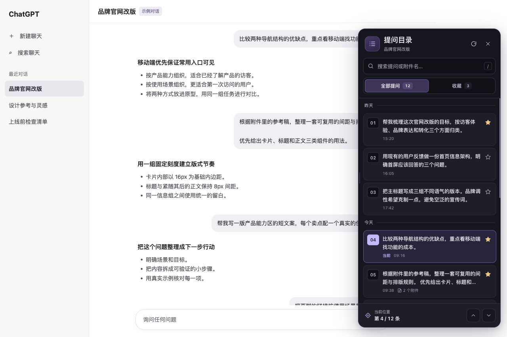
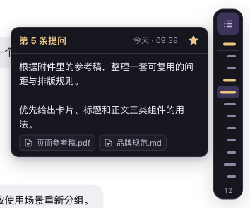

<h1 align="center">ChatGPT 提问目录 · Turn Outline</h1>

快速找回你在当前 ChatGPT 对话中发过的消息。悬停预览，点击定位，也可以搜索和收藏。

<a href="https://github.com/HFUT-zhengjiahao/chatgpt-turn-outline/releases/latest/download/chatgpt-turn-outline.zip"><strong>下载最新版 ZIP</strong></a> · <a href="https://github.com/HFUT-zhengjiahao/chatgpt-turn-outline/releases">版本记录</a> · <a href="README.en.md">English</a>

## 安装

1. 下载上方的最新版 ZIP 并解压。
2. 用桌面 Chrome 打开 `chrome://extensions/`，或用桌面 Edge 打开 `edge://extensions/`。开启「开发者模式」。
3. 点击「加载已解压的扩展程序」，选择解压后的 `chatgpt-turn-outline` 文件夹。这个文件夹里有 `manifest.json`。
4. 打开或刷新一条 ChatGPT 对话。页面右侧会出现提问目录。

需要查看浏览器操作截图时，可参考官方安装说明。 [Chrome](https://developer.chrome.com/docs/extensions/get-started/tutorial/hello-world#load-unpacked) · [Edge](https://learn.microsoft.com/en-us/microsoft-edge/extensions/getting-started/extension-sideloading)

更新时，把新版本的文件覆盖到浏览器原先加载的扩展文件夹，在扩展管理页点「重新加载」，再刷新 ChatGPT。沿用原路径可以保留本机收藏。

## 界面预览

## 使用

- 每条**侧边短杠**代表一条用户提问。悬停显示预览，点击直接定位。当前正在阅读的提问会高亮。
- 长对话的短杠列表可以用滚轮滚动，完整目录的第一条短杠固定在顶部。目录只加载了一部分时，悬停预览会注明编号属于已加载的提问。键盘聚焦后，用上下键、Home / End 浏览，按 Enter 定位。
- 点击预览卡或目录列表中的星标，即可**收藏**或取消收藏。收藏后的短杠以金色标记，收藏会在刷新、关闭页面和切换对话后保留。目录顶部可切换「全部提问」和「收藏」，搜索会匹配所选范围。
- 桌面**预览卡片**宽 280px，高度随内容变化，最多 184px。长提问可在卡片内滚动，附件名单独显示。窄屏或矮窗口会按可用空间缩小卡片。
- **展开目录**：点击短杠上方的目录按钮、扩展图标，或按 `Alt+Shift+O`。输入区外按 `/` 也可直接打开搜索。
- **搜索**：仅匹配用户提问和附件名，大小写不敏感。`Enter` / `Shift+Enter` 在匹配提问之间前进、后退。
- **上下条**：`Alt+↑` / `Alt+↓`，或目录底部的上下箭头。
- 点击目录底部的「当前位置」，即可清空搜索、切回全部提问，并在目录中显示正在阅读的那条提问。
- **退出**：`Esc` 先取消进行中的定位，再清空搜索或收起目录。手动滚动聊天正文也会取消自动定位。
- **调整宽度**：拖动目录左边缘；双击或按 Home 恢复 360px，左右键每次调整 20px，配合 Shift 为 40px。
- 侧边短杠、提问预览和展开目录采用**独立深色主题**。淡紫色标记当前位置，已收藏的提问显示金色星标。
- 桌面侧栏会为聊天正文留出空间。**窄屏**或聊天区放不下侧栏时，目录会改用底部面板，点击提问定位后自动收起。

每次刷新页面或切换对话都会回到收起状态。目录不展示回答，也不提供回答搜索或回答跳转。

## 数据处理

- 只从同源 ChatGPT 接口读取当前会话；按 `current_node` 回溯当前分支。
- 目录在页面内存中只保留用户提问、附件名、时间及消息 ID；回答仅记录 ID，用于把阅读位置对应到提问，不保留回答正文。
- 接口响应中的完整消息树只在解析期间使用；不上传到第三方服务，不保存聊天正文、搜索词、宽度或展开状态。
- 收藏通过扩展的 `storage` 权限写入 `chrome.storage.local`，仅保存会话 ID 与提问 ID，不保存提问或回答正文，不使用云同步。取消某个会话的最后一个收藏会删除该会话的收藏记录。
- 收藏按会话和消息 ID 区分，多个标签页的写入由后台串行处理，页面之间同步收藏标记。
- 不向网站的 localStorage 或 IndexedDB 写入数据。启动时仅删除旧版本的 `ctoa:settings:v1`、`ctoa:bookmarks:v1` 两个键。
- 认证令牌只临时保留在页面内存中，刷新或关闭页面后释放。
- 切换对话会立即清空旧目录和搜索，取消旧会话请求与定位任务。
- 收起状态也会同步新提问；回答生成时不会因回答内容变化反复请求会话接口。
- 接口失败时先显示网页已加载的提问，并逐步延迟重试；后续刷新失败不会清空先前成功读取的完整目录。

以上描述的是插件自身的数据处理，ChatGPT 网站和浏览器管理各自的聊天记录及缓存。

## 实现与限制

扩展使用 Manifest V3，无需构建或安装第三方运行时依赖。`background.js` 处理工具栏、快捷键和收藏写入。`content.js` 读取当前对话，渲染目录并定位提问。

长对话通常只在 DOM 中保留部分消息。插件优先读取当前分支的完整提问列表，再按消息 ID 定位；必要时滚动触发懒加载。除了滚动高度，还会观察已加载的消息 ID，兼容总高度不变的虚拟列表。定位可以取消，单次最多尝试约 30 秒。

仅在 `/c/...` 会话页显示，不包含跨对话搜索或共享链接目录。依赖 ChatGPT 的内部接口及 DOM 标记，网站改版可能需要适配。接口不可用时，目录范围限于页面已加载的消息。
